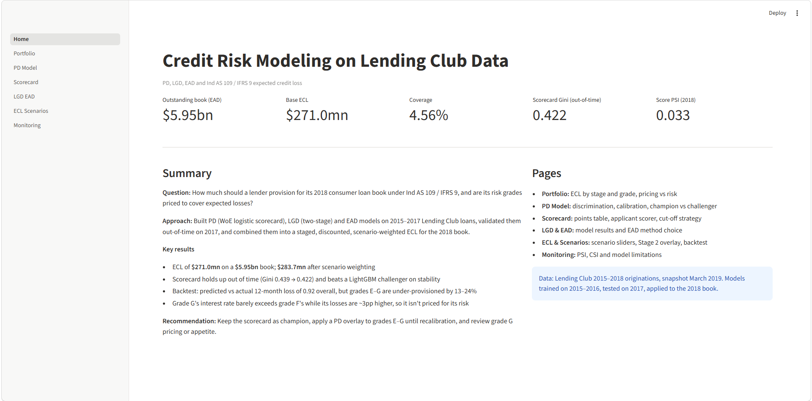
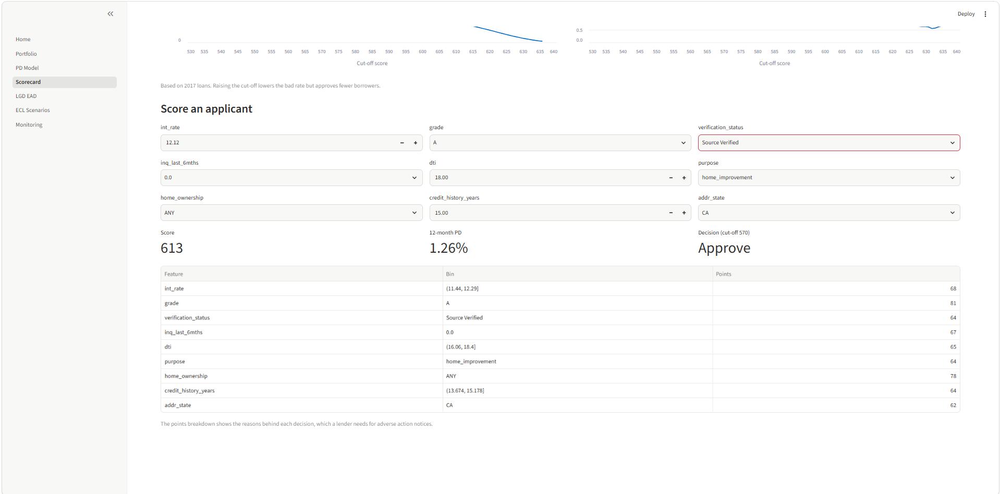

# Credit Risk Modeling on Lending Club Data (PD, LGD, EAD, ECL)

**Live dashboard:** [https://creditrisk26.streamlit.app/](https://creditrisk26.streamlit.app/)

An end-to-end credit risk project: PD, LGD and EAD models built on Lending Club loans, combined into an Ind AS 109 / IFRS 9 expected credit loss (ECL) for a live loan book, with out-of-time validation, a loss backtest, risk-based pricing analysis and model monitoring.



## Summary

**Question:** How much should a lender provision for its 2018 consumer loan book, and are its risk grades priced to cover expected losses?

**Approach:** PD (WoE logistic scorecard), LGD (two-stage) and EAD models trained on 2015–2016 loans, validated out-of-time on 2017, and applied to the 2018 book with three-stage classification, discounted lifetime ECL and scenario weighting.

**Key results**

| Area | Result |
|---|---|
| ECL | $271.0mn on a $5.95bn book (4.56% coverage); $283.8mn scenario-weighted |
| Staging | 94.6% / 3.8% / 1.6% of loans; coverage 2.76% / 7.35% / 90.44% |
| PD scorecard | Gini 0.439 train → 0.422 out-of-time; KS 0.307 |
| Challenger | LightGBM Gini 0.442 out-of-time (+2 pts) but overfits (0.504 train) |
| LGD | Predicted 0.900 vs actual 0.899; low discrimination (flat ~90%) |
| EAD | Payment schedule MAE 0.019 vs regression 0.143 → schedule used |
| Backtest | Predicted / actual 12-month loss: 0.92 overall, 0.76 for grade G |
| Stability | Score PSI 0.002 (2017), 0.033 (2018) |

**Recommendation:** Keep the scorecard as champion; apply a PD overlay to grades E–G until recalibration; review grade G pricing, which earns a lower risk-adjusted yield than grade F.

## Methodology

**Data:** Lending Club 2015–2018 originations (snapshot March 2019). Train 2015–2016, out-of-time test 2017, live book 2018. Default = charged off, default or 31–120 days late. The 12-month default flag is inferred from the last payment date. Post-origination fields are excluded to avoid leakage.

**PD:** Decile binning with Weight of Evidence, IV ≥ 0.02, backward elimination on p-values and coefficient signs, logistic regression, scorecard scaled to 600 points at 50:1 odds with PDO 20. LightGBM as challenger.

**LGD:** Two-stage model on charged-off loans with an 18-month recovery window: logistic regression for any recovery, linear regression for the recovery rate.

**EAD:** Linear regression on CCF, benchmarked against the amortization schedule.

**ECL:**
- Stage 3: 31+ days past due
- Stage 2: 1–30 days past due, or FICO down 60+ points and now below 640 (a 40-point rule was rejected as it flagged 12% of loans on score noise)
- 12-month PD converted to a monthly hazard; ECL summed monthly over 12 months (Stage 1) or remaining life (Stage 2), with scheduled EAD and discounting at the loan rate
- Probability-weighted across upside, base and downside PD scenarios

**Validation and monitoring:** Out-of-time Gini/KS, calibration by decile, 12-month loss backtest by grade, PSI on score and CSI by feature.

## Dashboard

| Page | Contents |
|---|---|
| Portfolio | ECL by stage and grade, pricing vs risk |
| PD Model | ROC, KS, calibration, champion vs challenger |
| Scorecard | Points table, cut-off strategy, live applicant scorer |
| LGD & EAD | Model results and EAD method choice |
| ECL & Scenarios | Scenario and Stage 2 overlay sliders, backtest |
| Monitoring | PSI, CSI, limitations |



## Limitations

- Origination PD only (no monthly payment history), so Stage 2 lifetime ECL is likely understated
- Scenario multipliers and weights are illustrative, not from a macroeconomic model
- LGD reflects Lending Club's debt sales and is undiscounted
- One-year backtest in a benign credit environment
- Risk-adjusted yields exclude funding, servicing and operating costs

## Repository

```
notebooks/
  01_data_prep.ipynb     data cleaning, default flags, time-based split
  02_pd_model.ipynb      WoE scorecard, feature selection, LightGBM challenger
  03_lgd_ead.ipynb       two-stage LGD, EAD with schedule benchmark
  04_ecl.ipynb           staging, ECL engine, scenarios, backtest, pricing, PSI/CSI
app/                     Streamlit dashboard
artifacts/               saved models and results used by the app
```

## Run locally

1. Download `accepted_2007_to_2018Q4.csv.gz` from Kaggle (Lending Club loan data) into `data/`
2. `pip install -r requirements.txt` (plus `statsmodels`, `lightgbm`, `matplotlib` for the notebooks)
3. Run notebooks 01 → 04 in order
4. `streamlit run app/Home.py`